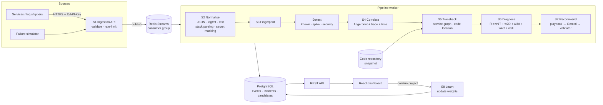

# Smart Log Analyzer

**Intelligent incident diagnosis, traceback and fix recommendation for distributed applications.**
B.Tech final-year project, G.L. Bajaj Institute of Technology & Management (group GC_2026_029).

The system collects logs from many services, groups related failures into incidents, follows the
failure back through the service graph to the code that caused it, ranks the root-cause candidates
with an explainable score, and recommends a fix. The design principle is **evidence first,
reasoning second**: every conclusion is backed by log events, traces, code or deployments, and the
AI only explains evidence the system has already collected.

## Quick start (lite mode, no installation of databases)

```bash
# 1. backend  (Python 3.12)
cd backend
pip install -r requirements.txt
cp .env.example .env            # optional: put your GEMINI_API_KEY here
python -m uvicorn app.main:app --port 8000

# 2. frontend (Node 20+)
cd frontend
npm install
npm run dev                     # http://localhost:5173   login: admin / admin123
```

Without `DATABASE_URL` and `REDIS_URL` the backend uses a local SQLite file and an in-memory queue,
so it runs on any laptop. Without `GEMINI_API_KEY`, recommendations come from the known-error
playbook and rule-based guidance.

## Full stack (Docker)

```bash
cp .env.example .env            # set GEMINI_API_KEY and change the secrets
docker compose up --build       # http://localhost:8080
```

This starts PostgreSQL 16 (JSONB and full-text search), Redis 7 (Redis Streams with consumer groups),
the FastAPI API with its pipeline worker, an extra scalable worker
(`docker compose up --scale worker=3`), and the React app served by Nginx.

## Architecture



| Stage | Module | What it does |
|---|---|---|
| S1 Ingest | `app/api/ingest.py` | API-key auth, size and rate limits, publishes the batch to the bus and returns 202 |
| S2 Normalise | `app/pipeline/normalize.py` | JSON / logfmt / plain text → one schema; Python, Java and Node stack traces; masks passwords, tokens, cards and emails |
| S3 Fingerprint | `app/pipeline/fingerprint.py` | Removes variable values and hashes service + error type + top app frames, so the same failure always gets the same id |
| Detect | `app/pipeline/detect.py` | Known-error signatures, rate spikes against each fingerprint's own baseline, critical events, brute-force logins |
| S4 Correlate | `app/pipeline/correlate.py` | Groups events into incidents by fingerprint, trace/request id and time; unrelated failures stay separate |
| S5 Traceback | `app/pipeline/traceback.py` | Rebuilds the service graph from spans; maps the innermost app stack frame to the repository (Python `ast`, Java signatures) |
| S6 Diagnose | `app/pipeline/rank.py` | Scores every candidate on 5 signals (below), each with a human-readable reason |
| S7 Recommend | `app/pipeline/recommend.py`, `llm.py` | Known playbook first; otherwise Gemini gets only the evidence pack and must cite evidence ids; the validator checks the answer |
| S8 Learn | `app/pipeline/feedback.py` | Confirm/reject adjusts the ranking weights and remembers confirmed root causes |

### Root-cause score

`R = w1·T + w2·D + w3·A + w4·C + w5·H`. Every signal is between 0 and 1, and the weights sum to 1.

| Signal | Meaning | Evidence used |
|---|---|---|
| **T** temporal precedence | how early the failure started | first error timestamp per candidate |
| **D** dependency position | deepest failing service, and how many services it impacts | service graph from spans |
| **A** anomaly | rate compared with the fingerprint's own baseline | event counts |
| **C** code & change | stack resolved to code, recent deployment, failing file changed in it | repository snapshot + deployment records |
| **H** history | known signature, or similarity to past incidents whose root cause was confirmed | playbook + feedback + similar-incident search |

**Confidence** follows the IDF: the magnitude of R plus the agreement between signals.

`confidence = 0.5·R + 0.3·agreement + 0.2·lead over the next candidate`

- *Agreement* is the share of the five signals that independently point at the candidate.
- The result is shown as high, medium or low, with the full breakdown.

**Similar past incidents** (`app/pipeline/similar.py`) are found in two ways:
- the same fingerprint, or
- token similarity of the error type and the message template.

A confirmed match raises H, appears on the incident page together with the fix that was used, and is given to the AI as evidence.

## Evaluation

```bash
cd backend && python -m app.evaluation --runs 20      # writes docs/evaluation.md (+ .json)
```

Each run replays all four scenarios **overlapping in time**, on an isolated database, with three confounders:
- clock skew, so the gateway's symptom errors appear *first*
- an unrelated "red-herring" gateway deployment
- harmless noise errors

The simulator knows which scenario produced every line, so the results are scored exactly against ground truth.

Latest results ([docs/evaluation.md](docs/evaluation.md), 20 runs, about 3,000 events):

| Metric | Result |
|---|---|
| Incident detection / root cause top-1 | 100% / 100% |
| Grouping F1 (pairwise) / false-positive incidents | 1.000 / 0 |
| Mean time to detect (log time) | 1.7 s |
| Top-1 using **one** signal only: T / D / A / C / H | 62.5% / 100% / 25% / 75% / 50% |

The data is synthetic, so real-world accuracy will be lower. The ablation shows why the signals are combined: temporal order alone is fooled by clock skew, and code & change alone is fooled by unrelated deployments.

### Security
- Dashboard login uses HMAC-signed, expiring bearer tokens, and login attempts are rate-limited.
- Each project ingests with its own API key. Only the key's SHA-256 hash is stored.
- Secrets are masked during normalisation, *before* anything is stored or sent to the AI.
- Every API input is validated with Pydantic, with size limits. CORS is restricted, and security headers are set.
- The AI sees only the evidence pack. Its answer must cite real evidence ids, and unsafe steps are blocked by the validator.
- The containers run as a non-root user.

## Presentation walkthrough (about 5 minutes)

1. **Log sources → Start live traffic.** Normal logs flow from 7 services in 3 formats (see Overview and the live log stream).
2. **Start the drill "Payment database overloaded after a new release".** About 10 s later an incident appears.
3. **Open the incident.** The *Summary* answers four questions: what happened, where it started, why we think so, and how to fix it.
   - *Root cause* tab: ranked suspects with payment-service on top, and a plain-language reason for each of the five clues.
   - *Service map & code* tab: gateway → checkout → payment, with payment as the starting point. The code line is `payment/repository.py` `charge_card`, a file changed in release v2.4.1.
   - *Recommended fix* tab: fix steps that cite evidence (E2, E5, …), marked "Verified against evidence".
4. **Ask AI again:** Gemini writes the recommendation from the evidence only; expand "Evidence used" to show what it saw.
5. **Answer "Yes" to "Is this correct?"** The clue weights change (see *Settings → What the analyzer has learned*). This is S8 learning.
6. **Drill "Password-guessing attack":** a security incident, raised to critical because a login succeeded after 14 failures.
7. **Drill "Cache server goes down":** matched by the known issues library, so no AI call is needed.
8. **Log search:** search `NullPointerException` and open a line to see the parsed Java stack and the original (masked) log line.
9. **Upload a log file** (Log sources → "Inventory crash (Java)" sample → Analyse file). A plain log file becomes an incident.
10. **History:** run the payment drill again after confirming it. The new incident's *History & feedback* tab shows the earlier incident and its fix, and its confidence rises.

The **How it works** page in the app explains the nine processing steps, the five clues and a glossary in plain language.

## Sending real logs

The project API key is `INGEST_API_KEY` in `backend/.env`; it is also shown on the *Log sources* page.

```bash
curl -X POST http://localhost:8000/api/v1/ingest \
  -H "X-API-Key: $INGEST_API_KEY" -H "Content-Type: application/json" \
  -d '{"events": [{"level":"error","service":"billing","message":"Timeout calling ledger"}]}'

python -m app.simulator.cli db_pool_exhaustion      # replays a scenario over HTTP like a log shipper

# a whole log file (JSON lines / logfmt / text with multi-line stack traces)
python -c "import json,sys;print(json.dumps({'content':open(sys.argv[1]).read(),'replay':True}))" app.log \
  | curl -X POST http://localhost:8000/api/v1/ingest/text -H "X-API-Key: $INGEST_API_KEY" \
         -H "Content-Type: application/json" -d @-
```

Sample log files are in `frontend/public/samples/`. The dashboard can also upload files (Log sources page).

Interactive API documentation is at http://localhost:8000/docs.

## Tests

```bash
cd backend && python -m pytest -q
```

The tests replay all four scenarios through the pipeline and assert the expected root cause, code
location, deployment link, playbook match and security detection. They also cover authentication,
the feedback-driven weight update, the confidence score, similar-incident retrieval, and log-file
splitting and upload.

## Project layout

```
backend/
  app/api/          REST endpoints (auth, ingest, events, incidents, system)
  app/pipeline/     S2-S8 stages + worker
  app/simulator/    ShopFlow failure scenarios, runner, CLI and log-file export
  app/evaluation.py accuracy evaluation against ground truth
  sample_repo/      code snapshot used by the traceback stage
  tests/
frontend/src/       React + Vite + Tailwind dashboard
frontend/public/samples/  sample log files for the upload feature
docs/evaluation.md  latest evaluation results
docker-compose.yml  PostgreSQL, Redis, API, worker, Nginx
```

## Known limitations (prototype)
- Tables are created at startup (`create_all`). Alembic migrations are the next step.
- If a worker crashes, its unacknowledged Redis Stream messages are not reclaimed yet (`XAUTOCLAIM`).
- Code analysis uses Python `ast` plus Java signature heuristics. Tree-sitter would add more languages.
- `npm audit` reports a ReDoS advisory in `picomatch`, which is used only by the Vite build tooling. It is not part of the shipped bundle.
